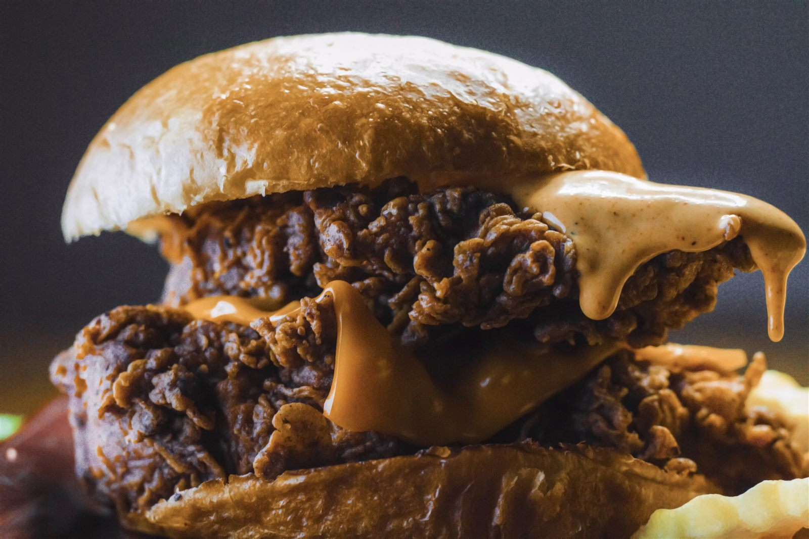

# Krunch website

The online ordering site for **Krunch**, my fried-chicken food brand in Lahore (2023–2024). Customers browse the menu, order for delivery and track their order; the owners manage the menu, orders and reviews from an admin dashboard.



## Features

**Customers**
- Sign up and log in (passwords stored as bcrypt hashes)
- Menu by category, cart and checkout with a delivery address and location
- Cash on delivery or JazzCash, with an order status page
- "My orders" history and reviews

**Admin**
- Dashboard of orders with status updates
- Add, edit and delete menu items with photos
- Approve or remove customer reviews

## Built with
PHP, MySQL/MariaDB, HTML and CSS, run locally on XAMPP. Database access uses prepared statements (PDO and mysqli).

## Run it locally

1. Install [XAMPP](https://www.apachefriends.org/) and start **Apache** and **MySQL**.
2. Copy this folder into `htdocs`, for example `C:\xampp\htdocs\krunch-website`.
3. Open phpMyAdmin (http://localhost/phpmyadmin), create a database called `krunchwebsite` and import `schema.sql`. It contains the tables, menu categories and menu items, with no users or orders.
4. Create the first admin. Make a password hash:
   ```
   php -r "echo password_hash('choose-a-password', PASSWORD_DEFAULT);"
   ```
   then run this in phpMyAdmin's SQL tab:
   ```sql
   INSERT INTO admins (name, email, password) VALUES ('Admin', 'admin@example.com', '<the hash>');
   ```
5. Open http://localhost/krunch-website/krunchwebsite.php. Log in at `login.php` with the admin email to reach the dashboard.

The five menu photos are in `uploads/` (from the [@krunchlahore](https://www.instagram.com/krunchlahore/) Instagram). New items' photos are uploaded from the admin menu page. To show a payment QR code on the order status page, add your own `qr.png` to the project folder.

The database login is XAMPP's default (`root`, no password), set at the top of each page. Change it before putting the site on a real server.
